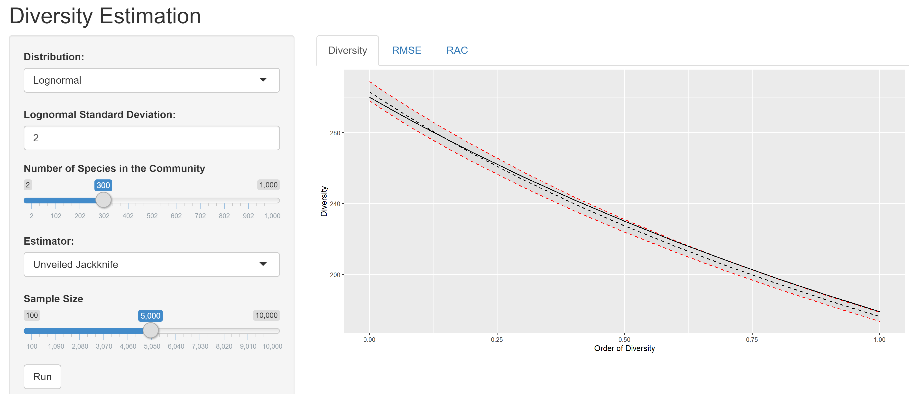

# Estimation of Diversity

A shiny application to assess the efficiency of diversity estimators applied to undersampled communities.

The theory is detailed in the paper [*Practical Estimation of Diversity from Abundance Data*](https://hal-agroparistech.archives-ouvertes.fr/hal-01212435).



## Quick start

Run `app.R` and choose:

- The actual community:
  - Distribution: log-normal by default.
  - Distribution parameters: standard deviation of the log-normal distribution is 2 by default.
  - Number of species: 300 by default.
- The estimator used: The unveiled jackknife by default.
- The simulation options: 10 simulations by default.

The output plots are:

- The rank-abundance curve (Whittaker plot) of the community species.
- The actual and estimated diversity profiles.
- The root mean squared error of the estimation.

Run it directly from GitHub:

```
library("shiny")
runGitHub("EricMarcon/estimation")
```

## Parallel computing

Running hundreds of simulations is encouraged by computer intensive.
The app supports their parallel computation with the [Futureverse](https://www.futureverse.org/).
Before running the app, set your plan.
To use all cores but one of your computer's CPU, run:

```
library("future")
plan(multisession, workers = availableCores(omit = 1))
```

After use, release the resources by running:
```
plan(sequential)
```
